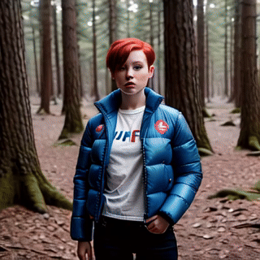

# Sketch to Image AI

Draw a rough sketch, describe it in a prompt, and get a realistic image back.
Built on Stable Diffusion 1.5 + ControlNet, with a FastAPI backend, a
single-page canvas frontend, and a multi-scene **Story Mode** that keeps a
character consistent across scenes.



## Features

- **Sketch to image** – draw on a canvas, add a prompt, and ControlNet
  (`scribble` or `canny`) follows your shapes while the prompt sets the style.
- **Refinement pass** – optional img2img refinement for extra detail.
- **Text to image** – prompt-only generation.
- **Story Mode** – up to 10 scenes per request. Character, location, style,
  action and mood are anchored across scenes (IP-Adapter + prompt anchoring).
- **Video prototype** – experimental image-to-video (Stable Video Diffusion)
  scripts under `tests/video_*.py`, with their own requirements.

## Requirements

- Python 3.10 or newer (developed and tested on 3.10)
- An NVIDIA GPU with CUDA is strongly recommended (CPU works but is very slow)
- Disk space for model downloads (several GB, cached by Hugging Face)

## Setup

```bash
# 1. Create and activate an environment
python -m venv .venv
.venv\Scripts\activate          # Windows
# source .venv/bin/activate     # Linux / macOS

# 2. Install PyTorch first, matching your CUDA version (example: CUDA 12.4)
pip install torch torchvision --index-url https://download.pytorch.org/whl/cu124

# 3. Install the remaining dependencies
pip install -r requirements.txt

# 4. Create your local config (optional – every value has a default)
copy .env.example .env          # Windows
# cp .env.example .env          # Linux / macOS
```

Models are downloaded from the Hugging Face Hub the first time the server
starts, so the first launch takes a while.

## Run

```bash
python backend/main.py
```

Then open <http://localhost:8000>. The server binds to `127.0.0.1` only. To
expose it on your network, change the `host` in `backend/main.py` (note that
CORS is currently open to all origins).

## Usage

1. Draw a sketch on the canvas.
2. Write a prompt (for example `a beautiful house in countryside, realistic photo, golden hour, 4k`).
3. Click **Generate**. Both the sketch and the prompt are needed: the sketch
   gives the shape and layout, the prompt gives the content and style.

### API

| Method | Path              | Purpose                                   |
|--------|-------------------|-------------------------------------------|
| GET    | `/`               | Web UI                                    |
| GET    | `/health`         | Status, CUDA availability, active model   |
| POST   | `/generate`       | Sketch + prompt to image                  |
| POST   | `/generate-text`  | Prompt-only image                         |
| POST   | `/generate-story` | Multi-scene Story Mode (max 10 scenes)    |

Story Mode request (minimal):

```json
{
  "scenes": [
    { "prompt": "a young woman with short red hair, wearing a blue jacket, standing in a room, cinematic" },
    { "prompt": "the same woman walking in a park", "location": "a park", "mood": "calm" }
  ],
  "seed": 42
}
```

## Configuration

All settings are environment variables (read from `.env`); see
[`.env.example`](.env.example) and `backend/config.py`.

| Variable              | Default                                  | Meaning                                  |
|-----------------------|------------------------------------------|------------------------------------------|
| `MODEL_ID`            | `runwayml/stable-diffusion-v1-5`         | Base Stable Diffusion model              |
| `CONTROLNET_ID`       | `lllyasviel/sd-controlnet-scribble`      | Default ControlNet                       |
| `VAE_ID`              | `stabilityai/sd-vae-ft-mse`              | VAE                                      |
| `IMG_SIZE`            | `448`                                    | Default image size                       |
| `INFERENCE_STEPS`     | `30`                                     | Default sampling steps                   |
| `GUIDANCE_SCALE`      | `7.5`                                    | Default prompt guidance                  |
| `USE_IP_ADAPTER`      | `true`                                   | Enable IP-Adapter for Story Mode         |
| `IP_ADAPTER_SCALE`    | `0.1`                                    | IP-Adapter strength                      |
| `STORY_SAME_SEED`     | `true`                                   | Reuse the seed across story scenes       |
| `STORY_BASE_STRENGTH` | `0.90`                                   | Base img2img strength between scenes     |

`.env.example` ships with the values the project was tuned with (for example
`MODEL_ID=SG161222/Realistic_Vision_V5.1_noVAE`).

## Tests

The `test_story_*.py` files in the repo root are unit tests for Story Mode
prompt logic and the API schema:

```bash
python test_story_anchor.py
```

`test_sd.py` and `test_controlnet.py` are GPU smoke tests that write sample
images next to the script. `tests/story_regression.py` runs end-to-end story
generation against a running server (`python tests/story_regression.py --base-url http://localhost:8000`).

## Video prototype (optional)

The Stable Video Diffusion prototype uses a separate environment. See
[`requirements-video.txt`](requirements-video.txt) and `tests/video_*.py`.

## Project structure

```
backend/     FastAPI app, Stable Diffusion pipelines, config
frontend/    Single-page canvas UI
docs/        README assets
tests/       Story regression + video prototype scripts
outputs/     Generated images (git-ignored)
uploads/     Uploaded sketches (git-ignored)
```

## Model licenses

This project downloads third-party models at runtime and does not redistribute
them. Check each model's license before any commercial use: Stable Diffusion
1.5 / Realistic Vision (CreativeML OpenRAIL-M), ControlNet, IP-Adapter, and
Stable Video Diffusion (non-commercial community license).

## License

No license has been specified yet.
